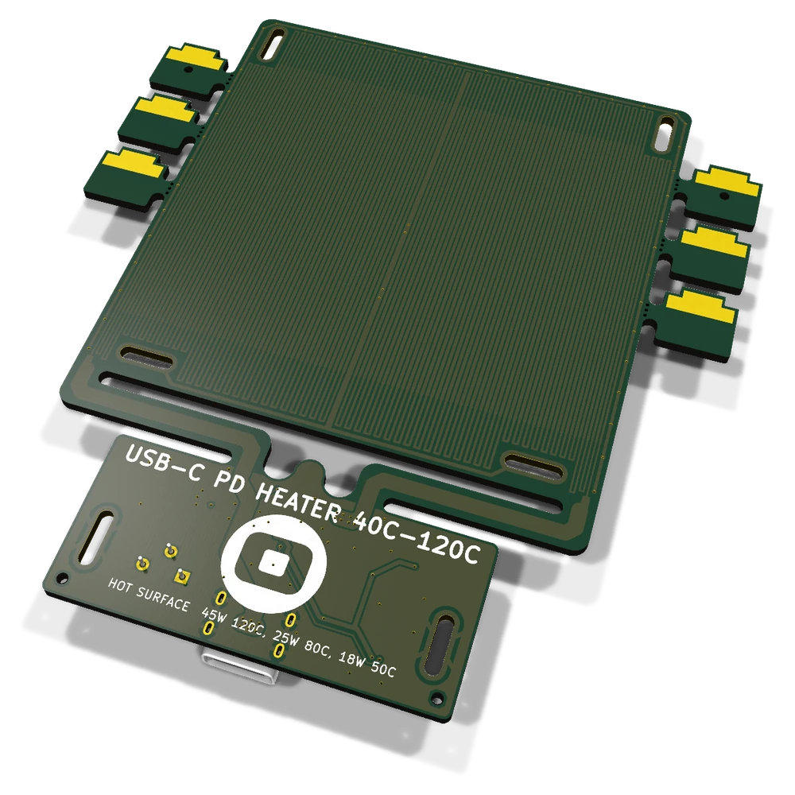
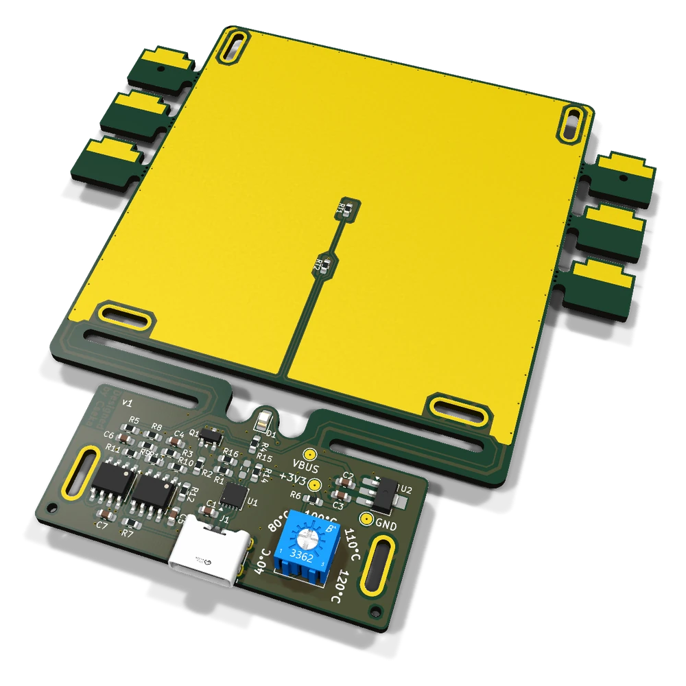

# USB-C PCB heater, 100 °C, two controller variants

  
  

<em>Top (the work surface) and underside of the analog board as it comes from the fab, with the six break-off legs still attached. These are 3D renders of the KiCad board; no board has been built yet.</em>

**Status (2026-11-14, rev B): ready to order; nothing ordered, nothing tested on hardware. The analog version is the one going forward. Its board is routed by hand in KiCad. The files for JLCPCB in `hw/analog/production/` were exported on 2026-11-14 at 15:05 and checked against the board; for assembly use `positions_corrected.csv` (see "Placement file corrections"). The temperature is set with a trimmer, 43 to about 120 °C.**

How the design got here, with its dead ends and mistakes, is in [`DEVELOPMENT.md`](DEVELOPMENT.md).

One 2-layer FR-4 board that plugs into a USB-C PD charger, heats a 70 × 70 mm area to 100 °C and holds it (analog board: adjustable, 43 to about 120 °C). The top is completely flat: the heater trace is the top copper under solder mask, and every component sits on the underside. The board stands on legs that snap off the same PCB.

There are two versions of the electronics on the same heater, built to compare BOM size and cost:

- `hw/analog/` — a comparator thermostat (two LM393), no firmware. **Chosen.** Rev B uses only standard resistor values and JLCPCB basic parts wherever one exists; a trimmer sets the temperature. Its schematic and board are edited by hand in KiCad, so `gen/build.py analog` must not be run (it would overwrite them).
- `hw/stm32/` — an STM32C011 with firmware in `fw/stm32/`. Kept as designed for the comparison; only the board outline changes (mouse bites, tooling holes) were carried over.

## Analog or STM32

|  | Analog (rev B) | STM32 |
|---|---|---|
| Parts to solder | 31 | 25 |
| - ICs and transistor | 5 | 5 |
| - connector, LED, NTCs, trimmer | 5 | 3 |
| - resistors | 15 | 10 |
| - capacitors | 6 | 7 |
| BOM lines (different parts) | 15 | 18 |
| Parts cost per board | $1.42 | $2.85 |
| Firmware / programmer | none | yes / ST-Link |
| Set point | 43 to 121 °C, trimmer RV1 | 100 °C, in the firmware |
| Temperature at 100 °C set-point (simulated) | 98.5–104 °C, switching every 2 s | 101 °C steady |
| Chargers | 45 W and up for full function | anything offering ≥ 16 W at 12 V or more |

The analog board has six more parts but two fewer different ones (6 resistor values, 2 capacitor values), and its parts cost half. The counts are those of `gen/circuits.py`; the hand-edited schematic has one more 100 nF capacitor (C7) and a USB-C socket that costs $0.16 less. `python3 gen/compare.py` prints the table and both part lists.

Every part has an LCSC number. Prices are JLCPCB parts-library prices for one piece, read on 2026-11-11 (`gen/jlc_parts.json`).

What each charger gives (heater 9 Ω):

| Charger offers | Analog | STM32 |
|---|---|---|
| 20 V at ≥ 2.5 A (60 W and up) | 20 V, 44 W | 20 V, 44 W |
| 20 V / 2.25 A and 15 V / 3 A (45 W) | 15 V, 25 W | 15 V, 25 W |
| 12 V at ≥ 2.5 A | 12 V, 16 W: about 3 min to 100 °C | 12 V, 16 W |
| 15 V / 2 A, no 12 V (typical 30 W) | 9 V, 9 W: tops out near 80 °C | 15 V, 25 W |
| 12 V at 1.5–1.7 A (18–20 W) | stays at 5 V (see the 12 V option below) | 12 V, 16 W |

The PD chip (HUSB238) walks the charger's offers from the highest voltage down and takes the first that can supply the current set on its ISET pin (2.5 A). The datasheet value for 2.5 A is 16.5 k; the analog board makes it from 22 k in parallel with 68 k (16.6 k), two values it already uses. The analog variant has only that rule, so it never overloads a charger but asks for 2.5 A at every voltage. The STM32 reads each offer's current over I2C, measures the heater, and picks the highest voltage whose current covers it with 8 % margin.

The top of the analog board carries the short form: `45W 120C, 25W 80C, 18W 50C`. A 45 W charger gives 15 V, which is enough for the whole dial. A 25 W charger gives 9 V and about 83 °C. An 18 W charger stays at 5 V and about 49 °C. These are model figures like the rest.

## How it works

**Heater.** 106 vertical lanes of top copper, 6.86 m long, 0.21–0.44 mm wide with 0.22 mm gaps, R20 = 9.0 Ω. The trace is narrower towards the edges and at the lane ends, which puts more heat where the plate loses more. Read back from the saved board files, the copper adds up to 9.00 Ω.

| At | Cold current | Cold power | Power at 100 °C | 25 → 99 °C (empty) |
|---|---|---|---|---|
| 20 V | 2.2 A | 44 W | 34 W | 34 s |
| 15 V | 1.7 A | 25 W | 19 W | 75 s |
| 12 V | 1.3 A | 16 W | 12 W | 166 s |
| 9 V | 1.0 A | 9 W | 7 W | settles at about 83 °C |

Holding 100 °C takes about 10 W in still air. These are model figures (`calc/thermal.py`), not measurements.

**Evenness (model).** With the sensor at 100 °C and nothing on the plate: the inner 50 × 50 mm is within 97–101 °C, the inner 60 × 60 mm within 93–101 °C, and the far corners (where the leg slots are) drop to about 89 °C. See `calc/out/evenness.png`.

**Underside.** A solid copper plane with the solder mask removed (bare HASL). It spreads heat and radiates about 2.4 W less towards the table than a masked surface would. 54 anchor vias sit around its edge on the generated board, tied together by a thin ground ring on the top layer so each via holds copper on both faces. The hand-routed analog board has 42 of them with the same ring, on the top, left and right edges; its bottom edge carries the sense lines. There are none along the internal cut-outs around the sensors, because the heater trace runs above them.

**Temperature sensing.** The NTCs are on the underside, but they follow the top copper: a copper bar in a channel between the two centre lanes of the heater is joined by four vias to a small island under each NTC, and that island is separated from the plane by a 1 mm gap. In simulation an underside-only sensor lets the top copper swing 96–119 °C under on/off control; with the bar it stays within 98.5–104 °C.

**Thermal break.** The heater zone is joined to the electronics tail only by two Z-shaped FR-4 links, 5 mm wide with about 23 mm of path. The heater feed and return run on top of them, a sensor signal and a ground trace underneath.

**Analog controller.** Two LM393 dual comparators (onsemi LM393DR2G, a JLCPCB basic part) on the 3.3 V rail. The LM393 is the two-channel version of the LM339, so the circuit is unchanged:

| Comparator | Job |
|---|---|
| U3 A | Thermostat on RT1. The trimmer RV1 sets the switch-off temperature between 43 and 121 °C; the heater comes back on 0.9 K below it. |
| U4 A | Limiter on RT2, an independent sensor: trips at 138 °C, resets at 127 °C. |
| U3 B | Limiter tripped → heater switch off. |
| U4 B | Limiter tripped → shorts the PD chip's VSET pin, which requests 5 V. Heater power drops 16×, even if the switch has failed short. |

The thermostat and the limiter sit in different chips, so one failed comparator IC cannot take out both.

RT1 and RT2 have separate reference dividers and leave the heater zone through different links, so no single open joint or trace in the sensor paths blinds both.

The two limiter outputs U3B and U4B take REF2, the limiter's own reference, as their threshold, not the set-point reference REF1. A fault that pulls REF1 to 0 V (an open joint at R6 or at RV1 pin 1, or the set-point net shorted to ground) therefore cannot stop them from acting: in `sim/manual` each of those faults, with both sensors far above the trip point, ends with the gate and VSET low. What is left: such a fault makes the thermostat ask for heat all the time, and the limiter then cycles the plate around 125 to 142 °C until the board is unplugged.
 In the simulated faults (switch shorted, RT1 open) the top copper peaks at 142 °C and then cycles between 125 and 142 °C until the board is unplugged, at any trimmer setting. That is above the glass transition of TG135 FR-4 and above the 125 °C rating of the NTCs. It was accepted for the fault case, because the limiter has to sit above the 120 °C setting.

The 15 fitted resistors are five values. Four are JLCPCB basic parts; the 3 M is an extended part that JLCPCB marks as preferred, which carries no fee:

| Value | Where |
|---|---|
| 22 k | limiter NTC pull-up R5; limiter reference top R8; ISET R1; gate R2; pull-ups R12, R13, R14 |
| 68 k | thermostat NTC pull-up R3; limiter hysteresis R11; ISET R16 |
| 3.3 k | thermostat reference bottom R7; limiter reference bottom R9 |
| 4.7 k | thermostat reference top R6, in series with the trimmer RV1; LED R4 |
| 3 M | thermostat hysteresis R10 (C23156) |

The gate resistor and the three pull-ups are 22 k, a value the board uses anyway. The gate edges take about 30 µs (an estimate from typical AO3400A figures). R15, which is not fitted, is 10 k because the PD chip's table reads 10 kΩ as a 12 V limit.

**Set point.** RV1 is a 50 kΩ ± 10 % single-turn trimmer (BOCHEN 3362P-1-503, C118910, through-hole). It is wired as a variable resistor between R6 and the reference REF1, with the wiper tied to the clockwise end; R6 comes first, on the 3.3 V rail. Turning clockwise lowers REF1 and raises the temperature. If the wiper loses contact the full 50 kΩ stays in circuit, which is the hottest setting, not an open reference.

| Rotation | 0 % | 12.5 % | 25 % | 37.5 % | 50 % | 62.5 % | 75 % | 87.5 % | 100 % |
|---|---|---|---|---|---|---|---|---|---|
| Heater off above | 43 °C | 66 °C | 80 °C | 90 °C | 98 °C | 105 °C | 111 °C | 116 °C | 121 °C |
| REF1 (across R7) | 1.361 V | 0.764 V | 0.531 V | 0.407 V | 0.330 V | 0.277 V | 0.239 V | 0.210 V | 0.188 V |

- R6 comes before the trimmer on purpose. The trimmer's three pins come through to the work surface. With R6 first none of them is on the 3.3 V rail, so a metal object that bridges a pin to ground draws at most 0.7 mA through R6 instead of shorting the regulator, for which Holtek states no short-circuit protection. Such a bridge still pulls REF1 to 0 V: the thermostat then asks for heat until the limiter takes over, as in the fault case above.
- The board has five labels around the trimmer on the underside (40, 80, 100, 110 and 120 °C), placed by hand. Measured at their centres they sit within about 2 K of the nominal scale for the 240° adjustment angle of a 3362: the 80 label at 80 °C, 100 at 98 °C, 110 at 111 °C, and 40 and 120 at the two end stops (43 and 121 °C). For an exact setting use a multimeter on REF1 (the pads of R7) with the table, or a thermocouple on the plate.
- The coldest setting does not depend on the trimmer's tolerance. The hottest does: 117 °C with a trimmer 10 % low, 124 °C with one 10 % high, and up to 127 °C if the 1 % parts and the NTC are also at their limits. The top copper peaks about 5 K above the switch-off temperature (125.5 °C at the nominal hottest setting, in the model). 100 °C is at 53.5 % of the travel.
- The limiter's lowest worst-case trip is 134 °C, so it stays out of the way in normal use.
- The top of the range needs a 15 V or 20 V charger. At 12 V the heater's full power only brings the plate to about 111 °C.
- R3 is 68 k to keep the reference low enough for the LM393 on a 3.3 V supply. Its input range is 1.8 V at 25 °C and 1.3 V guaranteed over its whole temperature range. REF1 is below 1.3 V for every setting above about 45 °C. In the last 1 % of the travel (43 to 45 °C) it reaches 1.36 V, which is inside the room-temperature range only: with the board in a cold room that setting is not guaranteed and may switch a few kelvin late or not heat. Turn the trimmer up slightly if that happens.
- Another trimmer value works with the same ratios, R6 = 0.094 × and R7 = 0.066 × the trimmer, between 10 k and 100 k. 50 k was kept because its R7 is the 3.3 k the limiter needs anyway.
- R6 is 4.7 k because that is also the LED resistor's value, which saves a BOM line.

The two NTC filter capacitors are 100 nF, the same part as the comparators' decoupling capacitor.

12 V option for small chargers: fit 10 k at R15 (limits the request to 12 V), fit 4.7 k at R1 and leave R16 empty (asks for 1.5 A). The board is then a fixed 12 V / 16 W heater on any charger.

**LED (analog).** A yellow 0805 (KT-0805Y, basic part) on the underside at the front edge of the tail, lit while the heater is energised. It shines down; from above its glow on the table shows through the gap between the tail and the heater zone. The top side has no hole at all.

**3.3 V rail.** HT7533-1 linear regulator, a JLCPCB basic part. The rail carries about 1.5 mA on the analog board, so its input and output capacitors are 1 µF 50 V 0603, the same part as C1; C3 stands right at the regulator's output and ground pins. This also keeps the capacitance on VBUS at 2 µF, inside the 10 µF that USB allows a device at plug-in. Holtek's application circuit draws 10 µF on both sides and states no minimum, so the 1 µF output capacitor is a choice, not a datasheet value: if the rail turns out noisy, a 10 µF 10 V 0603 (C19702, also a basic part) fits C3's pads. The STM32 board has 1 µF on the input and keeps 4.7 µF on the output, which is also the MCU's bulk capacitor.

**USB-C socket (analog).** J1 is a six-contact, power-only socket: SHOU HAN TYPE-C 6P(073), C668623, $0.039. It is an extended part at JLCPCB, as is every one of the 227 six-contact USB-C sockets in their library. It has the same pad positions and pin order as the HRO TYPE-C-31-M-17 (C283540, $0.199) that the footprint and the 3D model are named after, and its datasheet asks for exactly the 0.5 × 1.2 mm stake slots that are on the board.

The SHOU HAN datasheet rates the socket at 3.0 A and 5.0 V. This board runs it at up to 20 V and 2.2 A, so it is used above its stated voltage. That was accepted on the reasoning that 5 V and 20 V are both low DC voltages; the sheet's insulation tests (100 V AC for one minute, 100 MΩ) are the same as on the maker's 20 V sockets. Sockets that JLCPCB lists for 20 V and that fit the same pads, should the choice be revisited (catalogue ratings, datasheets not read; stock on 2026-11-14):

| LCSC | Part | Price | Listed rating | Stock | Fit |
|---|---|---|---|---|---|
| C52711237 | HH 6P TYPE-C (Y026X) | $0.037 | 20 V, 3 A | 15,507 | Same pads and slots in LCSC's footprint; JLCPCB has no datasheet for it |
| C2798175 | USAKRO TYPE-C-6M-001 | $0.068 | 20 V, 3 A | 2,749 | Pads within 0.05 mm; its layout draws 0.6 mm wide slots |
| C22464426 | HRO TYPE-C-31-M-17A | $0.113 | 20 V, 5 A | 2,605 | Pads exact; its layout draws longer slots, 0.6 × 1.4 mm |
| C283540 | HRO TYPE-C-31-M-17 | $0.199 | 20 V, 5 A | 9,752 | Pads exact; the part the footprint was made for |

SHOU HAN's own 20 V series (C30167326 and its siblings) does not fit: its stake rows are 3.64 mm apart instead of 3.80 mm.

**STM32 controller.** STM32C011F4P6, firmware in `fw/stm32/` (7.5 KB of the 16 KB flash).

- Chooses the charger voltage as described above; heater off around every change.
- Measures heater current with a 20 mΩ shunt and an INA180 (1 V/A) and VBUS with a divider, so it knows the heater resistance. That gives the average trace temperature with no lag (copper, +0.393 %/K). The NTC calibrates it at each cold start and corrects it slowly in operation.
- PI control with 25 Hz PWM.
- Faults (heater off, LED blinks the code): 1 NTC open/short, 2 over-temperature, 3 current with the switch off, 4 trace and NTC disagree or no temperature rise, 5 over-current, 6 heater open or wrong resistance. Faults 2 and 3 also request 5 V, over I2C and by pulling VSET low.
- Independent watchdog; a 100 k pull-down keeps the switch off while the MCU is in reset.
- LED: fast blink while negotiating, solid while heating, a short off-blip every 2 s at temperature, two off-blips for a weak charger (9 V), 1 s on / 1 s off without PD power.
- UART log on the TX pad, 115200 baud, one line per second: time, state, VBUS mV, mA, heater mΩ, NTC, trace and control temperature (0.1 °C), duty, selected volts, fault.

Pins: PA0 NTC1, PA1 current, PA2 VBUS/11, PA3 optional NTC2, PA5 LED, PA8 gate (TIM1_CH1), PA11/PA12 SCL/SDA (bit-banged), PB6 UART TX, PB7 VSET, PA13/PA14 SWD.

## Ordering the PCB

Upload to JLCPCB:

- **Analog: `hw/analog/production/analog.zip`.** It was exported with the Fabrication Toolkit plugin on 2026-11-14 at 15:05 and is identical, layer by layer and hole by hole, to a fresh plot of the board as saved at 15:04. Export again after any further change to the board. Do not upload `hw/analog/analog_gerbers.zip`: that is the generated board of 2026-11-11.
- STM32: `hw/stm32/stm32_gerbers.zip`.

| Setting | Value |
|---|---|
| Layers / size | 2 / 94 × 100 mm (analog), 97 × 98 mm (STM32) |
| Material | FR-4 TG135 |
| Thickness | 1.6 mm |
| Copper | 1 oz (this sets the heater resistance) |
| Surface finish | HASL, lead-free |
| Remove order number | Analog: yes. The hand-routed board no longer carries the text `JLCJLCJLCJLC`; put it back on the underside to use "Specify a location" instead. STM32: "Specify a location" (the text is on the underside of the tail) |

Add a remark to the analog order: the bare copper underside of the heater zone is intentional, and the six pieces beside it are legs of the same board. The fab note that says so is on the User.Comments layer, which is not in the zip.

Two things decide the price and are not settled by this design:

- Recent reports say the $2 price is now tied to JLCPCB's desktop app, with about $4 on the web.
- The legs hang on mouse-bite tabs (six on the analog board, eight on the STM32 board). JLCPCB may treat that as a panel and add a fee.

The quote page shows both once the Gerbers are uploaded.

Legs of the analog board: three on each side of the heater zone. Each hangs on one tab, about 4 mm wide where it breaks, with a row of three 0.5 mm holes on the edge of the heater zone. The break is at the heater edge and the tab stub stays on the leg. A leg is 10 mm wide and holds the board 8.25 mm above the table; its 6.0 × 1.5 mm tongue goes into a plated slot of 7.4 × 1.9 mm. The tallest things underneath are the trimmer (4.9 mm) and a USB-C plug (about 4.9 mm below the board for a plug 6.5 mm thick).

Legs of the STM32 board (generated): eight, on two 3 mm tabs each, with the same row of holes.

## Having JLCPCB assemble it (analog board)

The board fits JLCPCB's Economic assembly: 2 layers, 1.6 mm, lead-free HASL, parts on one side, 0.5 mm smallest pin pitch.

| Order setting | Value |
|---|---|
| PCBA type | Economic |
| Assembly side | Bottom |
| PCBA quantity | 2 or 5 |
| Tooling holes | Added by Customer (four 1.152 mm holes: two in the bottom corners of the tail and one in the first leg on each side) |
| BOM file | `hw/analog/production/bom.csv` |
| CPL file | `hw/analog/production/positions_corrected.csv` (the plugin's `positions.csv` with the three corrections below) |
| Confirm Parts Placement | Yes ($0.45) |

### Placement file corrections

The plugin's `positions.csv` has three wrong rows. `positions_corrected.csv`, next to it, is the export of 2026-11-14 15:05 with only these three cells changed:

| Part | Column | In the file | Correct | What happens otherwise |
|---|---|---|---|---|
| U1 (PD chip) | Rotation | 90 | 0 | The chip sits a quarter turn off, its pins not on their pads |
| J1 (USB-C socket) | Mid Y | -147.5 | -146.18 | The socket is placed 1.3 mm too far towards the board edge |
| U2 (regulator) | Mid X | 65.25 | 65.92 | Pins 1 and 3 overlap their pads by only about 0.3 mm |

- **How they were found:** LCSC's own footprint of each polarised part was placed at the file's position and rotation, and its pins compared with the board's pads. Q1, U3, U4, D1 and RV1 land within 0.25 mm.
- **U1:** the plugin turns underside parts by 180° minus the KiCad angle, plus a correction from a table of footprint names. The table has `DFN-` and `UDFN-10` but nothing for this footprint, `WDFN-10-…`, so the 270° correction was not applied. In the preview, pin 1 belongs at the corner nearest C1.
- **J1:** KiCad's footprint anchor is 1.3 mm nearer the socket's mouth than the origin of LCSC's footprint for this socket.
- **U2:** the origin of LCSC's footprint is 0.67 mm from the body centre towards the three pins.
- **How sure:** the U1 rotation follows from the plugin's own rule as well as from the comparison. The J1 and U2 offsets assume that the origin of LCSC's footprint is JLCPCB's placement point; the placement preview shows whether that holds.
- **A new export from KiCad brings all three back** and makes `positions_corrected.csv` out of date. To make the corrections stick, add these fields to the footprints: U1 `FT Rotation Offset` = `270`, J1 `FT Origin` = `Center` (this leaves J1 0.16 mm off, which the stakes take up), U2 `FT Position Offset` = `-0.67,0`. They are worked out from the plugin's code and have not been tried.

### Cost

Estimate from JLCPCB's published fees (page updated 2026-10-22) and their parts library on 2026-11-11, for the generator's part list. That list has one 100 nF capacitor less than the hand-routed board and still has the HRO socket at $0.199: where JLCPCB places J1, the SHOU HAN socket makes each board $0.16 cheaper. `python3 gen/pcba.py` recomputes the table:

| | By hand: J1, RT1, RT2, RV1, 2 boards | By hand: J1, RT1, RT2, RV1, 5 boards | By hand: RV1 only, 2 boards | By hand: RV1 only, 5 boards |
|---|---|---|---|---|
| Setup | $8.18 | $8.18 | $8.18 | $8.18 |
| Stencil | $1.53 | $1.53 | $1.53 | $1.53 |
| Extended parts, $3.07 each | $3.07 | $3.07 | $9.21 | $9.21 |
| Soldering | $0.25 | $0.62 | $0.29 | $0.73 |
| Components | $2.06 | $5.15 | $2.52 | $6.30 |
| **Assembly total** | **$15.09** | **$18.55** | **$21.73** | **$25.94** |
| per assembled board | $7.54 | $3.71 | $10.86 | $5.19 |

Not in the table: the PCB itself (about $2–4 for five, more if the legs count as a panel), shipping and tax.

- **`bom.csv` and `positions.csv` list all 32 fitted parts, including the USB-C socket (J1), the two NTCs (RT1, RT2) and the trimmer (RV1).** The first two columns of the estimate assume those four are soldered by hand: untick them in JLCPCB's parts step. J1 and the NTCs are extended parts, so this saves two $3.07 fees. The trimmer is through-hole, which JLCPCB solders by hand at a charge the estimate does not include; it costs $0.16 at LCSC.
- Pads of unticked parts may still get solder paste and arrive with solder bumps. If J1's do, wick them flat before seating the socket.
- With those four left out, the only extended part with a fee is the PD chip. R10 (3 MΩ, C23156) is extended; on 2026-11-11 JLCPCB marked it as preferred, which has no fee. The lookup of 2026-11-14 shows only "extended", so look for the fee in the quote. Everything else is a basic part.
- All 15 LCSC numbers were looked up again on 2026-11-14: each is the intended part and in stock. The smallest stock is the PD chip with 17,680 pieces; the socket (C668623) has 233,612.
- The NTCs of the analog board are Sunlord SDNT1608X104F3950FTF (C919169, rated -55 to 125 °C). The STM32 board still lists the KUU part C2892545.
- **Older files in `hw/analog/` are not for ordering.** `analog_gerbers.zip`, `gerbers/`, `analog_bom.csv`, `analog_jlc_bom.csv`, `analog_jlc_cpl.csv`, `analog_pos.csv`, `analog_drc.json`, `layout.png` and the two renders describe the board before it was routed by hand. `analog.net`, `analog_schematic.pdf` and `analog_erc.json` were written on 2026-11-14 at 02:57, before R6 and the trimmer changed places.
- JLCPCB has no NTC thermistor among its basic or preferred parts (searched 2026-11-11).
- JLCPCB's fee page lists X-ray inspection for leadless packages, but a real quote for this board on 2026-11-11 had no X-ray charge for the DFN-10, so none is counted.
- The legs are soldered by hand afterwards.
- **Check the placement preview before paying**, U1, J1 and U2 in particular.

## Building one

1. Solder everything on the underside. The shopping list is `hw/analog/production/bom.csv` for the analog board and `hw/stm32/stm32_bom.csv` for the STM32 board. On a JLCPCB-assembled analog board only the parts unticked in the order are left to do: J1, RT1, RT2 and RV1 in the estimate above. RV1 is through-hole: its pins come out on the opposite face about 4 mm long, so cut them flush after soldering. Its three pads and the four grounded pads of the socket's stakes are the only bare metal on the work surface. U1 is a 3 × 3 mm DFN whose only ground is the centre pad, so it needs hot air or a hot plate.
2. Optional parts are left empty: R15 on the analog board; RT2, R11 and C8 on the STM32 board.
3. Snap off six legs; each breaks at the heater edge. Nip or file the tab stub off the leg (one on the analog board, two on the STM32 board). Push each tongue into a slot from the underside until the shoulders sit on the board, and solder both faces of the leg to the bare land. The tongue stops just below the top surface (0.1 mm on the analog board). Four slots are near the heater corners, two on the tail.
4. For metal objects, put polyimide tape on the heater surface: solder mask is the only insulation over a trace that sits at up to 20 V.
5. STM32 only: `make -C fw/stm32 flash` with an ST-Link on the pads marked 3V3 DIO CLK RST GND.

## First power-up

1. Analog: turn RV1 fully anticlockwise (the coldest setting, 43 °C) before the first power-up, and raise it afterwards.
1. Before plugging in, measure the heater: 9 Ω ± 12 % is expected (copper thickness varies). On the analog board measure between the VBUS pad and the drain of Q1, the pin that stands alone on one side of the transistor; the STM32 board has VBUS and HTR- pads. The STM32 firmware refuses anything outside ± 20 %.
2. Check that VBUS–GND and 3V3–GND are not shorted. The analog board has three test pads for this, labelled VBUS, GND and +3V3.
3. Plug in a PD charger. 3V3 should read 3.3 V and VBUS the voltage from the table above.
4. Watch the first warm-up with a thermocouple or thermal camera. Analog: the LED is on while heating and starts to flicker once the plate is at temperature.
5. Analog limiter: warm RT2 with a soldering iron. VBUS must fall to 5 V and the LED go out, and both must come back as it cools.
6. STM32: read the UART log; pull RT1's signal to ground with tweezers and check that the heater stops with fault 1.

## Simulating the analog controller

`sim/` holds three KiCad projects for KiCad's built-in SPICE simulator (ngspice). Open one, then Inspect → Simulator → Run. All use the board's references and values; parts that are not on the board are numbered from 101.

| Project | What it shows | What it assumes |
|---|---|---|
| `sim/manual/manual.kicad_pro` | The control circuit alone. The two NTCs are trimmers (RT1, RT2: resistance = position × 100 kΩ) that you turn in the simulator like the set-point trimmer RV1; each change runs 40 ms and shows whether the heater is on and the limiter tripped. | Stock models only (below). No plate, no PD chip, no regulator. |
| `sim/loop/loop.kicad_pro` | Closed loop, 150 s: the control circuit heats a thermal model of the plate from room temperature. Temperatures are plotted in volts (100 V is 100 °C). | The plate model of `calc/thermal.py`, the NTC's B-parameter law, a stand-in for the PD chip, a comparator model written for this project. |
| `sim/thresholds/thresholds.kicad_pro` | Open loop, 30 s: the plate temperature is a ramp, 10 °C per second up to 150 °C and back, so the switching points can be read off the time axis. | As `loop`, without the plate. |

### The manual project

- **Models:** KiCad's own resistor, capacitor, trimmer and DC source. The comparator is the long-circulated LM393 macromodel (header "created using PARTS version 4.03 on 03/07/90"), used unchanged in `sim/models/LM393.sub`; its origin could not be confirmed, the copy is from a public GitHub repository. The switch is a SPICE level-1 MOSFET with six numbers from the typical values of the AO3400A data sheet. `sim/models/stock.lib` holds only that and the wiring of two comparators into one package.
- **Temperature:** the simulation knows resistances, not temperatures. The sheet lists the NTC's nominal resistance for a few temperatures (100 kΩ at 25 °C, B = 3950 K) as an aid.
- **History:** KiCad reruns the simulation from scratch at every change, so a run cannot remember the previous setting. Each run starts as if the plate had just been colder (C4 and C6 start charged), which shows where things switch while warming up. Set `ic=0` in the simulation model of C4 and C6 to see where they switch back while cooling down.
- **Not simulated:** what the PD chip does when VSET is pulled low (R102 is only a pull-up so that the output shows a level), the 3.3 V regulator, the plate, the LED.
- **Checked with ngspice 45 on the netlist KiCad exports:** the heater switches off below 6977 Ω and on again above 7140 Ω at RT1, the limiter trips below 2654 Ω and resets above 3413 Ω at RT2. From the resistor values alone the figures are 6975, 7144, 2652 and 3428 Ω.

The schematic carries `.options method=gear`, which the comparator macromodel needs. Why this comparator model and this MOSFET model are used, and which ones failed first, is in `DEVELOPMENT.md`, section 13.

### The loop and thresholds projects

- **Things to change with the Tune tool:** RV1 (the trimmer's travel, 0 to 1), V101 (charger voltage), V102 (the 3.3 V rail), V103 (room temperature). R105 = 0.01 shorts the switch; R103 = 6.8M puts an object on the plate.
- **Stand-ins:** a 3.3 V source for the regulator, and a source for the charger and PD chip that gives 5 V while the limiter holds VSET low, about 0.1 s late (the real chip's delay is not specified).
- **Plate:** the numbers of `calc/thermal.py` as an RC ladder, with 1 V = 1 °C, 1 µA = 1 W, 1 MΩ = 1 K/W and 1 µF = 1 J/K.
- **Models:** `sim/models/heater_sim.lib`, written for this project. The LM393 is a behavioural comparator with offset, bias current and input range as parameters; the AO3400A is ngspice's power-MOSFET model fitted to the data sheet's typical values.
- **Input range at the coldest setting:** set `vhead=2.0` on U3 (its simulation model parameters) to see the comparator at the cold end of its temperature range. With the trimmer at 0 the heater then switches off at 45 °C instead of 43 °C, or does not heat at all with `oor=0`; at 100 °C nothing changes. What the real part does with both inputs above its range is not specified, so this shows the two possibilities that were programmed in, not a prediction.

Checked with ngspice 45 on the exported netlists (2026-11-13): 14 cases of the closed loop (trimmer at five positions, 12, 15 and 20 V, shorted switch, object on the plate, 10 and 35 °C room), each with and without recording all currents, all ran to the end in 1 to 3 s. The results agree with `calc/control_sim.py`: 99 °C after 34 s and 98.5 to 103.9 °C at the 100 °C setting, 125 to 142 °C with the switch shorted, thresholds at 100.0 / 99.1 °C and 137.5 / 126.4 °C.

**These two are not an independent check.** They are built from the same plate numbers, NTC law and assumed PD-chip behaviour as the Python model, so agreement shows only that the numbers were carried over correctly. The control wiring of all three projects matches the board schematic except in two places: the simulations still have the trimmer on the 3.3 V rail with R6 after it, and the heater-return net under its old name HTR_N. Two resistors in series give the same REF1 in either order, so the results stand.

Not checked for any of the three: they have not been opened in KiCad's simulator window itself, only run through `kicad-cli` and ngspice.

`sim/make_sim.py` draws the schematics (`--check` reruns the checks above). It refuses to overwrite an existing one unless called with `--force`, so changes made in KiCad are safe.

## What is checked, and what is not

The analog project in `hw/analog/` is edited by hand, so the script checks further down describe the STM32 board and the analog board as it was generated. `gen/circuits.py` and `gen/sheets.py` do not have the last changes of the hand-edited analog circuit: R6 ahead of the trimmer, the net name HEAT, the reduced set of test pads and the new socket.

**Checks of the hand-routed analog board (2026-11-14).** On the board as saved at 15:04 and the export of 15:05:

- **Rules:** ERC clean. DRC with no errors, nothing unconnected and schematic parity clean; the zone fills are current. The 17 warnings left are cosmetic: silkscreen over pads and at the socket's edge, one unused 3.3 V via under TP3, five VBUS track ends not centred on their vias.
- **Production files:** all nine Gerber layers and both drill files in the zip are identical to a fresh plot of the board made with the plugin's settings. The drill files hold 100 vias of 0.3 mm, three 0.8 mm trimmer holes, four 0.5 mm stake slots, six leg slots, 18 mouse-bite holes and four tooling holes.
- **BOM:** 15 lines, 32 parts, each with the value and LCSC number that the board has; R15 is left out as not fitted. All 15 LCSC numbers are the intended parts.
- **Placement file:** 32 rows, all on the underside; three rows are wrong, see "Placement file corrections".
- **Heater current path:** no track narrower than 0.9 mm on the way in or 1.0 mm on the way out, and eight vias at each layer change.

On the board as saved at 11:04 the same day, not repeated after the small changes that followed (two tooling holes, a few tracks moved, the socket's part number):

- **Pinouts:** every pin of U1 to U4, Q1, D1 and J1 is on the net its datasheet calls for. The PD chip's tables give 2.5 A for the 16.6 kΩ on ISET and 20 V for an open VSET pin; its exposed pad (1.7 × 2.4 mm) fits the 1.8 × 2.5 mm land.
- **Ground pads:** three 0.5 mm spokes on each pad that carries the heater's return current.
- **Heater:** the footprint is unchanged from the library (9.0 Ω).
- **Mechanics:** the socket's mouth stands about 1 mm proud of the board edge, so a plug's body clears the board. The legs leave 8.25 mm under the board.
- **Sensors:** the NTC pads are surrounded by solder mask inside the bare underside.
- **Cosmetic, left as they are:** part designators are 0.8 mm tall with 0.12 mm strokes and may print faint; R9 and R13 overlap; the warning line on the top runs over the eight VBUS vias; the logo is clipped at two stake pads of the socket.

The board has three test pads: VBUS, GND and +3V3 (TP1 to TP3).

Checked by `python3 gen/build.py` for both variants:

- schematic ERC clean, netlist identical to the circuit in `gen/circuits.py`, pin by pin;
- PCB DRC with no errors, nothing unconnected, schematic parity clean (remaining warnings are silkscreen over pads and the USB-C outline at the board edge);
- heater 9.0 Ω and ≥ 0.19 mm gaps, outline within 100 × 100 mm, no component on the top side, 54 anchor vias present.

Checked by `make -C fw/stm32 test`: 30 host tests of the firmware logic against a thermal and charger model (charger selection on five chargers, tolerances, every fault path, load step, warm start).

Not verified, in rough order of risk:

- **Nothing has run on hardware.** The thermal and control numbers are from models. The firmware's register-level layer (`fw/stm32/mcu/board.c`) compiles but has never met the chip.
- **HUSB238.** Its behaviour is taken from the datasheet; the I2C register map comes from Adafruit's library. The analog limiter depends on the documented "request follows the VSET resistance while running".
- **Placement file for JLCPCB assembly.** The three corrections rest on LCSC's footprints, not on anything JLCPCB has confirmed; their placement preview is the first real check.
- **USB-C socket above its rating (analog).** The SHOU HAN socket's datasheet says 3.0 A and 5.0 V; the board puts up to 20 V and 2.2 A on it, 2.5 A if the copper comes out thick. See "USB-C socket" above for the reasoning and the alternatives.
- **USB-C socket stake slots (analog).** They are 0.5 × 1.2 mm plated slots in 1.0 × 1.7 mm pads, which is what the SHOU HAN socket's datasheet and LCSC footprint ask for. 0.5 mm is believed to be JLCPCB's minimum for a plated slot; that limit was not confirmed.
- **Trimmer footprint and range (analog).** The footprint `fable:Potentiometer_3362P` is drawn from the Bourns 3362 datasheet (style P); the BOCHEN part is sold as the same package, but its own drawing was not available to check. Its pin positions agree exactly with LCSC's footprint for the BOCHEN part (compared 2026-11-14); the holes are 0.8 mm where LCSC's footprint has 0.9 mm. The temperature scale comes from nominal part values and the B-parameter NTC model.
- **Generator layout of the analog board.** `gen/circuits.py` gives RV1 a position that has never been built; the hand-routed board is the only layout with the trimmer.
- **3.3 V regulator with 1 µF on its output (analog).** Smaller than the 10 µF of the datasheet's circuit; look at the rail with a scope on the first board.
- **Assembly price.** Computed from published fees, not quoted.
- **Mechanical fit taken from the footprint, not the datasheet:** the length of the USB-C shell stakes against the flat top. (STM32 board only: the reverse-mount LED's lens in its 1.8 × 2.4 mm hole.)
- **LED visibility (analog).** How well the downward glow shows from above has not been tried.
- **Attended use only.** There is no thermal fuse. A heater stuck on at 20 V settles near 187 °C in the model; that is why the finish and solder should be lead-free.

## Files

| Path | What |
|---|---|
| `DEVELOPMENT.md` | How the design got here: decisions, dead ends, mistakes |
| `docs/` | The two pictures at the top of this page: renders of the hand-routed analog board, made with `kicad-cli pcb render` |
| `gen/build.py` | Regenerates everything: `python3 gen/build.py [analog\|stm32]` (about 1 min per board) |
| `gen/geom.py`, `gen/heater.py` | Board dimensions; heater trace generator |
| `gen/circuits.py`, `gen/parts.py` | The two circuits as code; part numbers and prices |
| `gen/sheets.py`, `gen/schematic.py` | How each schematic is drawn (groups, symbol positions, wires, notes); the writer that checks the drawing against the circuit. `python3 gen/sheets.py [analog\|stm32]` redraws and checks the schematic alone |
| `gen/board.py`, `gen/pcbkit.py` | PCB builder; pcbnew helpers |
| `gen/compare.py` | BOM comparison |
| `gen/pcba.py`, `gen/jlc_parts.json` | JLCPCB assembly estimate; prices, stock and basic/extended class of every part (`--refresh` re-reads them) |
| `calc/thermal.py`, `calc/control_sim.py` | Thermal model; control simulation and the analog resistor values |
| `fw/stm32/` | Firmware: `make`, `make test`, `make flash` |
| `sim/` | Three KiCad simulation projects of the analog controller (`manual`, `loop`, `thresholds`), their SPICE models and the script that draws them |
| `hw/lib/` | Generated footprints (heater, leg, slot, mouse bite, tooling hole, reverse-mount LED, 3362P trimmer) |
| `hw/lib/fable.3dshapes/` | 3D models KiCad's library does not ship: the USB-C socket and the trimmer, EasyEDA's STEP models of LCSC parts C283540 and C118910, placed by their pins. The socket model is the HRO part's; the SHOU HAN socket now fitted has the same outline to within 0.3 mm. The PD chip uses KiCad's own 3 × 3 mm DFN-10 model. The offsets are in `MODELS` in `gen/board.py` |
| `hw/analog/`, `hw/stm32/` | KiCad 10 project, Gerber zip, BOM, position file, JLCPCB BOM and CPL files, schematic PDF, renders, ERC/DRC reports. For the analog board everything but the KiCad project is older than the hand-routed layout |
| `hw/analog/production/` | The analog board's files for JLCPCB, exported from KiCad with the Fabrication Toolkit plugin: `analog.zip` (Gerbers and drill files), `bom.csv`, `positions.csv`. `positions_corrected.csv` is `positions.csv` with three cells corrected |

The generator imports the circuit-as-code toolkit of the parent project (`../gen/eda/`: circuit model, symbol library reader, placement, grid router) and `../calc/thermal_budget.py`; it does not modify them.

### Schematics

Each schematic is one A3 sheet, drawn in functional groups with wires between the pins. Power nets use power symbols; a local label only names a wire. The one exception is the I2C pair on the STM32 sheet, which is joined by the labels SCL and SDA. The analog sheet has one wire crossing, the STM32 sheet three.

The board's net names follow the schematic: a labelled net is `/NAME` on the PCB, and an unlabelled one has the name KiCad derives from a pin, such as `Net-(U1-ISET)`. To move something, edit `gen/sheets.py`; the writer refuses a drawing whose wires do not give exactly the nets of the circuit.
